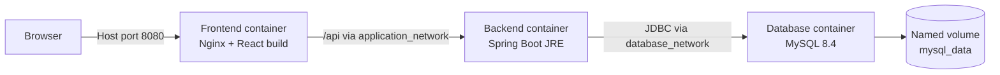

# Container Architecture

## Exposure matrix

| Component | Container port | Published to host | Reachable from |
|---|---:|---:|---|
| Frontend/Nginx | 8080 | `${APP_PORT:-8080}` | Browser/host |
| Backend | 8080 | No | Frontend container |
| MySQL | 3306 | No | Backend container |

## Request flow

1. The browser opens `http://localhost:8080`.
2. Nginx serves `/usr/share/nginx/html/index.html` and production assets.
3. React sends requests to relative URLs such as `/api/articles`.
4. Nginx forwards those requests to `backend:8080` without changing `/api`.
5. Spring Boot executes business logic and uses Hibernate/JDBC.
6. MySQL stores tables in `/var/lib/mysql`, backed by the named volume.
