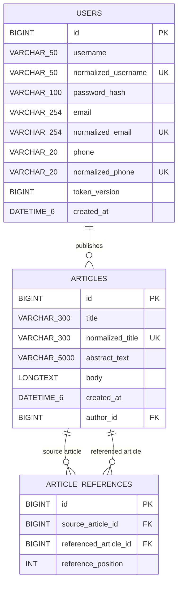

# Entity-relationship design

## Design decisions

- `users.id`, `articles.id`, and `article_references.id` are generated primary keys.
- `articles.author_id` is a mandatory foreign key, so every new article has a persistent author.
- Username, email, and phone are normalized before their uniqueness constraints are checked.
- Nullable unique email/phone columns allow different users to omit one contact method while preventing duplicate non-null values.
- `token_version` supports server-side invalidation of all existing JWTs after logout or password change.
- Password plaintext and password salt are never stored separately. The `password_hash` field contains the PBKDF2 algorithm marker, iteration count, random salt, and derived hash.
- The article-reference association remains an explicit entity because it needs a primary key and `reference_position`.
